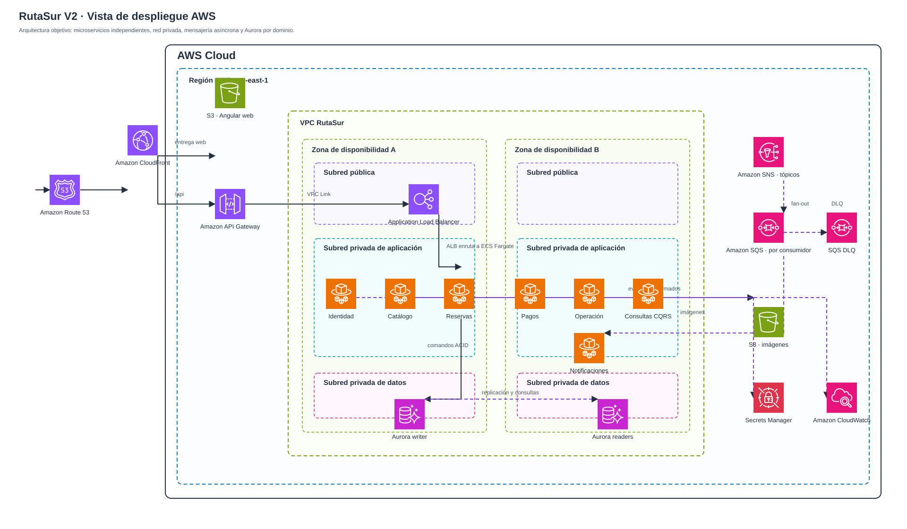
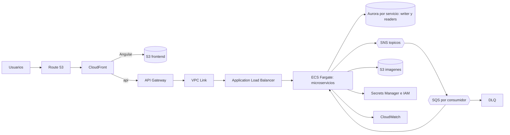

# C4 V2 — Vista de despliegue y contenedores AWS

> Nivel C4: **contenedores**, complementado por una **vista de despliegue objetivo**. No es un diagrama de flujo: muestra el recorrido técnico, los límites de red y los componentes que alojan o conectan los contenedores de RutaSur.

RutaSur V2 evoluciona hacia microservicios independientes. Cada uno conserva arquitectura hexagonal interna y aplica CQRS donde la lectura requiere un modelo propio. Esta página documenta el destino empresarial en AWS; localmente se mantienen PostgreSQL y Floci para desarrollar sin depender de AWS.

[Abrir el diagrama editable en Draw.io](images/despliegue-aws-v2.drawio)

> La fuente oficial del diagrama es el archivo Draw.io anterior. El SVG se genera con `generar-vista-despliegue-aws.ps1` a partir de los iconos oficiales AWS versionados en `images/aws/`. Los diagramas de flujo, secuencia y eventos se documentan por separado y no se mezclan aquí.

## Recorrido estructural

1. **Route 53** resuelve el dominio y **CloudFront** entrega Angular desde el bucket **S3 de frontend**.
2. Las solicitudes bajo `/api` viajan desde CloudFront a **API Gateway**.
3. API Gateway atraviesa la frontera privada por **VPC Link** hacia el **Application Load Balancer**.
4. El ALB enruta al microservicio correspondiente, ejecutado como tarea independiente en **ECS Fargate** dentro de subredes privadas y en más de una zona de disponibilidad.
5. Cada servicio usa su Aurora PostgreSQL dueño: endpoint **writer** para comandos ACID y **readers** o proyecciones CQRS para lectura escalable.
6. Los hechos confirmados se distribuyen mediante **SNS**, una **SQS por consumidor** y su **DLQ**. S3 aloja imágenes, Secrets Manager protege secretos y CloudWatch concentra telemetría.

## Componentes y responsabilidades

| Capa | Componente | Responsabilidad |
| --- | --- | --- |
| Entrada | Route 53, CloudFront y S3 frontend | Dominio, distribución del Angular estático y caché perimetral. |
| API | API Gateway, VPC Link y ALB | Frontera HTTP, conexión privada a la VPC y balanceo hacia tareas saludables. |
| Cómputo | ECS Fargate | Tareas independientes para Identidad, Catálogo, Reservas, Pagos, Operación, Consultas y Notificaciones. |
| Persistencia | Aurora PostgreSQL por dominio | Base privada por microservicio; writer para comandos y readers para consultas permitidas. |
| Archivos | S3 imágenes | Imágenes de experiencias; Catálogo conserva sus metadatos y referencias. |
| Eventos | SNS, SQS y DLQ | Publicación, fan-out, reintentos, aislamiento de fallos y consumo idempotente. |
| Operación | Secrets Manager, IAM y CloudWatch | Secretos, permisos mínimos, logs correlacionados, métricas, trazas y alarmas. |

## Consistencia y escalamiento

Reservas mantiene la transacción ACID local y el bloqueo de cupos sobre su Aurora writer. Tras confirmar el cambio se publica un hecho desde outbox. SNS lo reparte a las colas de quienes necesitan reaccionar; los consumidores son idempotentes y una falla agotada termina en DLQ. Las proyecciones CQRS se actualizan asíncronamente y permiten escalar Catálogo o Consultas sin escalar Reservas ni Pagos.

El pago sigue siendo una acción explícita posterior a la reserva. Este diagrama muestra los componentes que permiten ese comportamiento, no el orden temporal de sus mensajes.

## Modelo editable

## Entornos

| Aspecto | Local educativo | Objetivo AWS |
| --- | --- | --- |
| Bases | PostgreSQL local, una base por servicio | Aurora PostgreSQL por dominio con writer y readers |
| Eventos | Floci en Docker | SNS, SQS por consumidor y DLQ |
| Ejecución | Spring Boot local | Imágenes ECR y tareas ECS Fargate detrás de ALB |
| Frontend | Angular servido por CLI | S3 distribuido por CloudFront, dominio Route 53 |
| Configuración | Variables locales | Secrets Manager, IAM y CloudWatch |

Las decisiones completas están en [ADR-002](../adr/002-migracion-a-microservicios-v2.md), [ADR-003](../adr/003-pago-explicito-posterior-a-reserva.md) y [ADR-004](../adr/004-plataforma-aws-objetivo.md).
