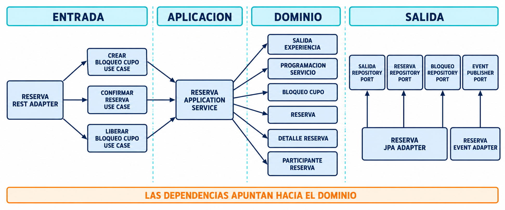
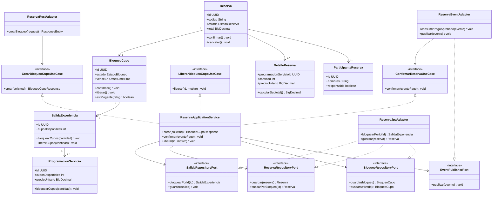

# Clases V2: dominio y casos de uso de Reservas

El diagrama muestra el interior hexagonal del microservicio de Reservas. Los controladores REST, JPA y SNS/SQS son adaptadores; no son dependencias del dominio.



> La imagen es la versión de presentación. El Mermaid siguiente conserva la fuente editable y precisa de las dependencias.



## Dependencias permitidas

```text
adapter/in/rest        -> port/in
adapter/in/events      -> port/in
application/service    -> port/out y dominio
adapter/out/jpa        -> port/out
adapter/out/messaging  -> port/out
dominio                -> ninguna tecnología
```
