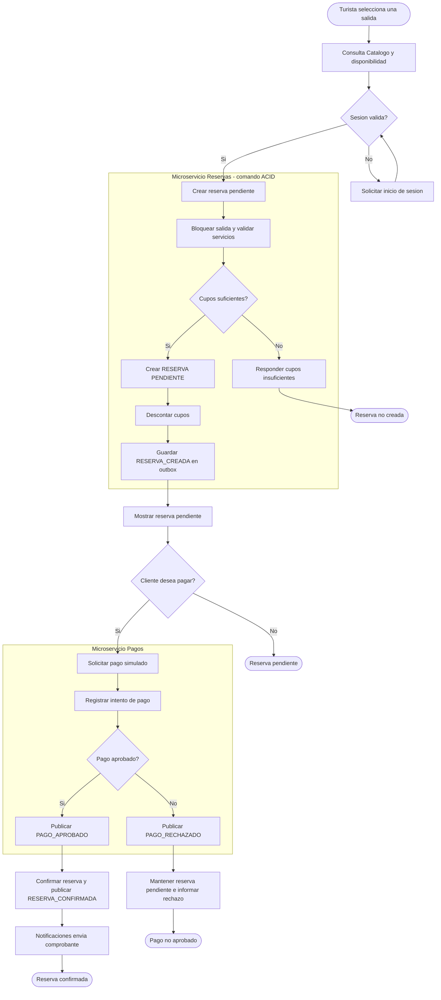

# Flujo V2: reserva pendiente y pago explícito

Crear una reserva y pagarla son acciones distintas. Reservas conserva el cupo y crea una reserva pendiente; el cliente decide después si inicia el pago simulado.

> La imagen es la versión de presentación. El Mermaid siguiente conserva la fuente editable y precisa del flujo.

## Regla de consistencia

La decisión `Cupos suficientes?` se toma únicamente en el modelo de escritura de Reservas. Las consultas del catálogo o de CQRS no pueden confirmar disponibilidad. Pagos solo participa después del comando explícito del cliente.
