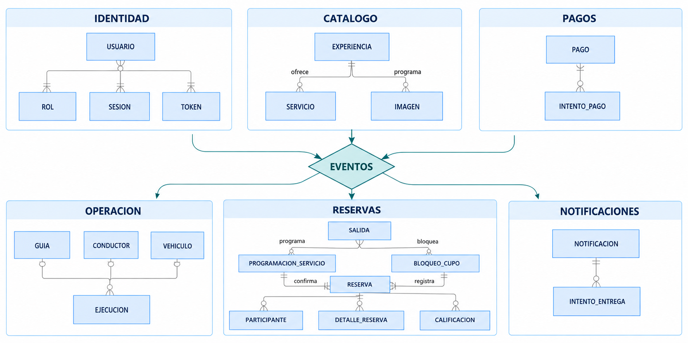
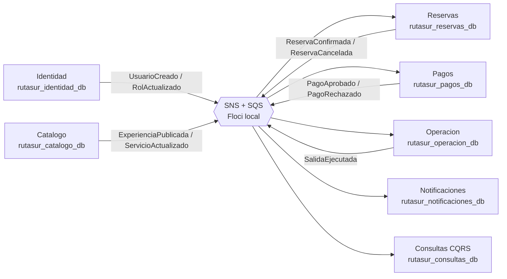
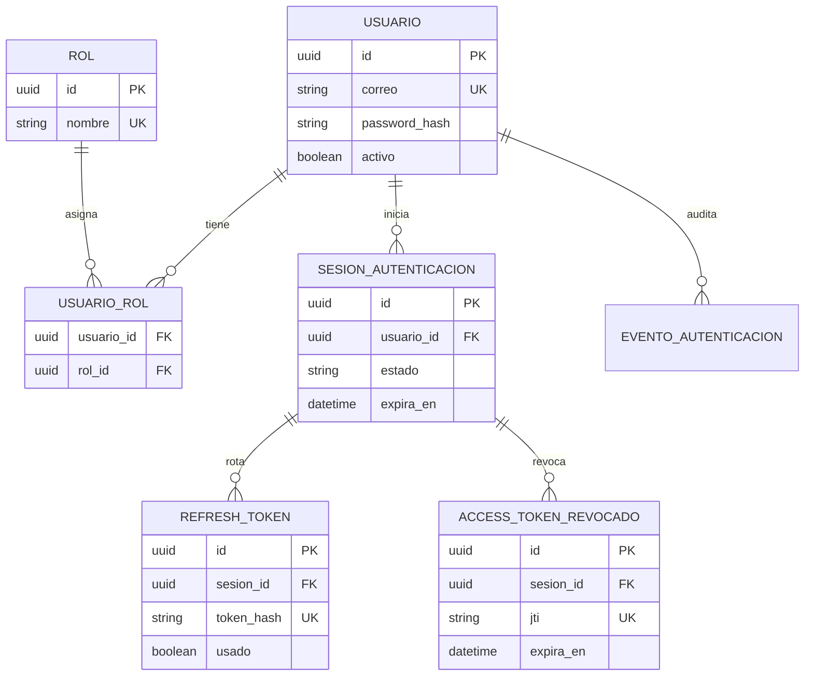
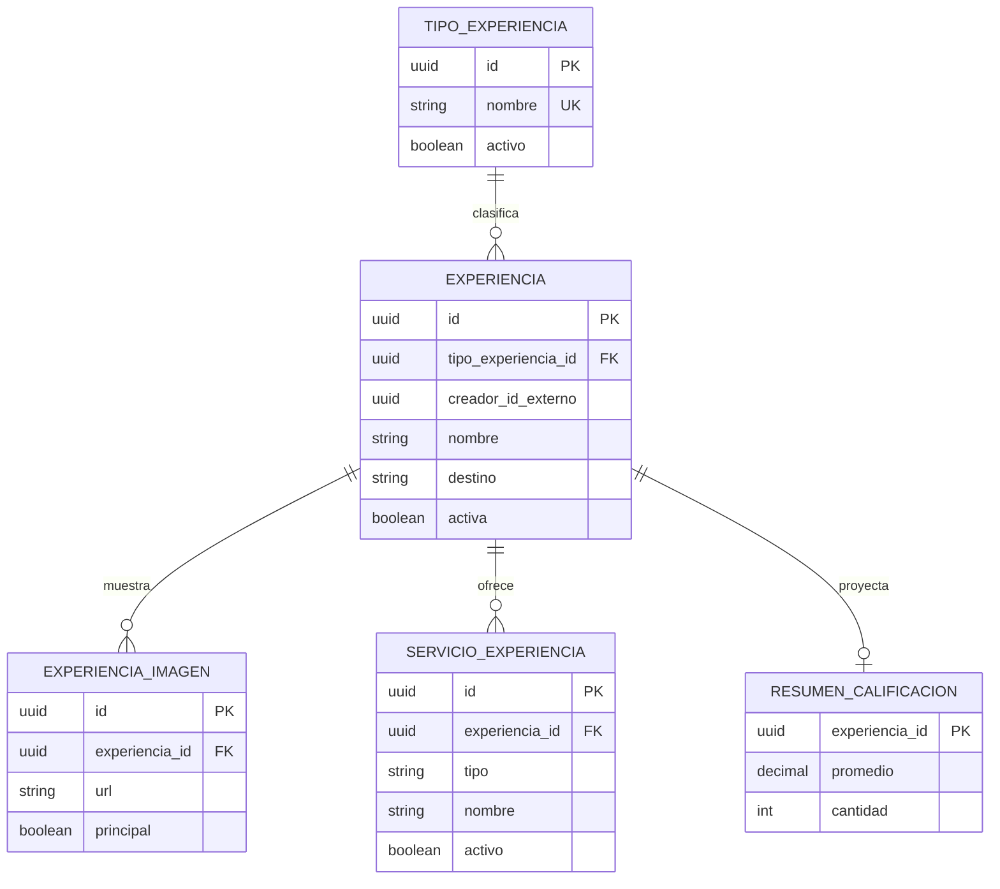
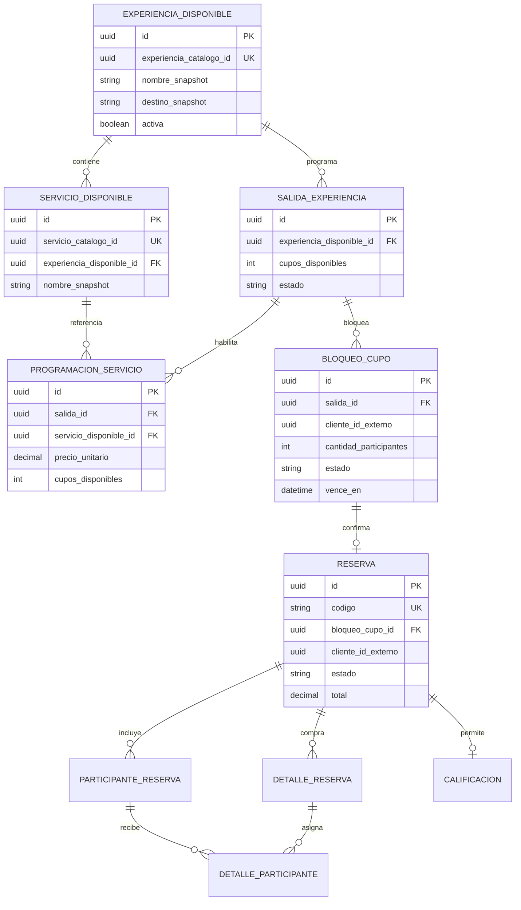
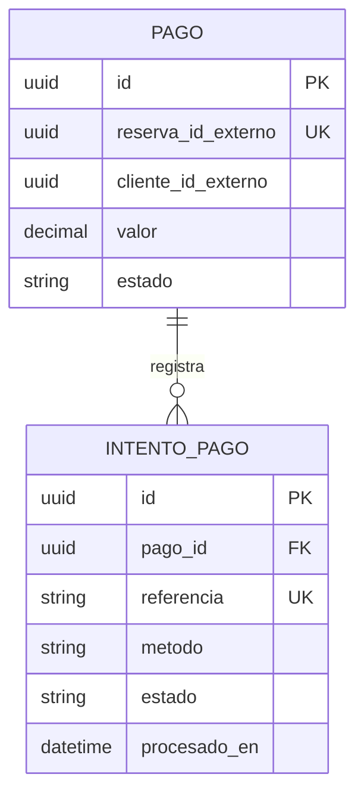
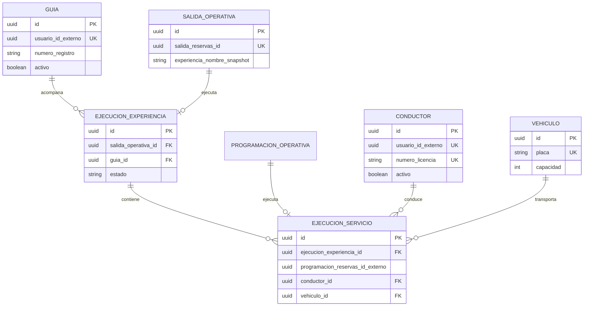
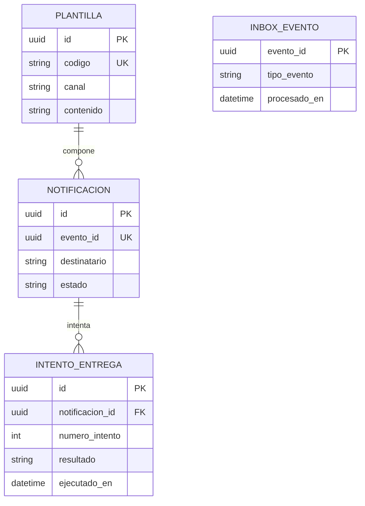
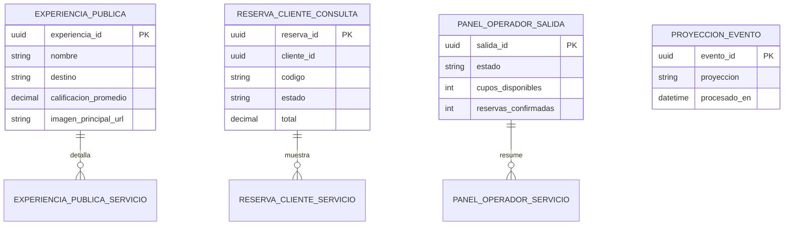
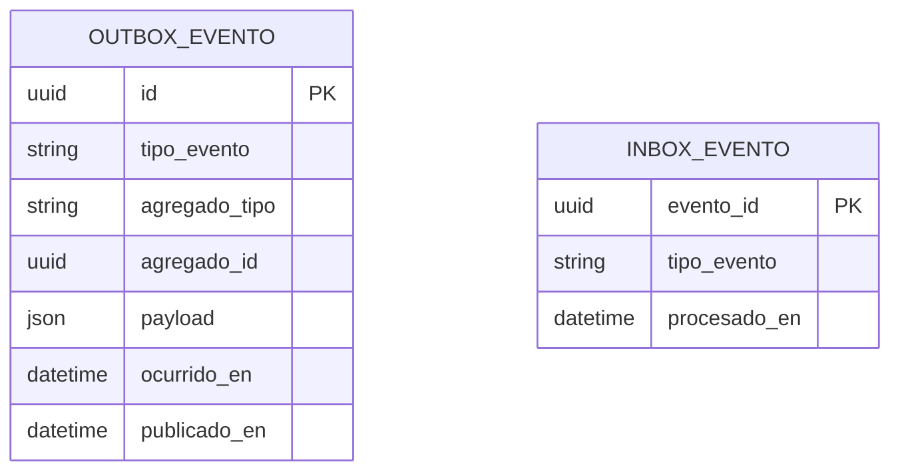

# Modelo visual de datos V2

> Estado: diseño de referencia previo a la migración de la V1. No modifica la V1 etiquetada como `v1`.

## Decisiones de persistencia

- Cada microservicio es dueño exclusivo de su base de datos y de sus migraciones Flyway.
- En el entorno local se podrán ejecutar las bases en una sola instancia PostgreSQL, pero cada una tendrá base, usuario y migraciones independientes.
- En producción cada dueño se despliega sobre Aurora PostgreSQL: los comandos llegan al endpoint writer y las lecturas que admiten consistencia eventual se dirigen a readers o proyecciones CQRS.
- No hay llaves foráneas, consultas SQL ni transacciones distribuidas entre microservicios.
- Las referencias externas se identifican con el sufijo `_externo`; su consistencia se mantiene por contratos y eventos.
- Cada productor de eventos usa `outbox_evento`; cada consumidor persistente usa `inbox_evento` para tolerar entregas duplicadas.
- Los modelos de `Consultas` son proyecciones CQRS y no son fuente de verdad para comandos.

## Mapa global: propiedad de datos y comunicación

El diagrama representa comunicación por eventos, no acceso a tablas ajenas. El servicio que publica un hecho nunca conoce la base de datos de quien lo consume. En AWS, SNS distribuye a una SQS por consumidor y cada una tiene DLQ; Floci reproduce esa topología en local.

## 1. Identidad

Dueño de cuentas, roles y ciclo de vida de autenticación. Los perfiles operativos no duplican usuarios: Operación conserva únicamente `usuario_id_externo`.

## 2. Catálogo

Dueño del contenido comercial de una experiencia. No administra cupos ni reservas.

## 3. Reservas

Es el límite de consistencia fuerte de RutaSur. Es dueño de salidas, disponibilidad, bloqueo temporal y reserva. Aquí se conserva el bloqueo pesimista local para impedir sobreventa.

`experiencia_disponible` y `servicio_disponible` son referencias locales alimentadas por eventos de Catálogo; no son copias que Catálogo pueda leer o modificar directamente.

## 4. Pagos

Pagos es dueño de sus intentos y de la decisión técnica del pago. La reserva se identifica con un UUID externo, sin FK entre bases.

## 5. Operación

Administra los recursos y la ejecución real. Los identificadores de guía, conductor, salida y programación son referencias externas o proyecciones recibidas por eventos.

## 6. Notificaciones serverless

La función serverless consume eventos desde una cola propia. Guarda el evento recibido y cada intento de entrega para permitir idempotencia y reintentos.

## 7. Consultas CQRS

Estas tablas no participan en comandos de reserva, pago ni disponibilidad. Se regeneran mediante eventos y priorizan velocidad de lectura para Angular y el panel administrativo.

## Tablas transversales técnicas

Cada servicio productor tendrá `outbox_evento`; Reservas, Pagos, Operación, Notificaciones y Consultas tendrán `inbox_evento` o `proyeccion_evento` según su responsabilidad.

La especificación de atributos, tipos, índices y restricciones se encuentra en `docs/database/modelo-v2.dbml`.
