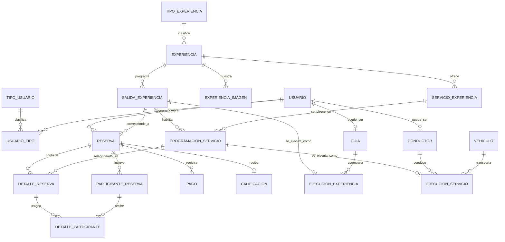
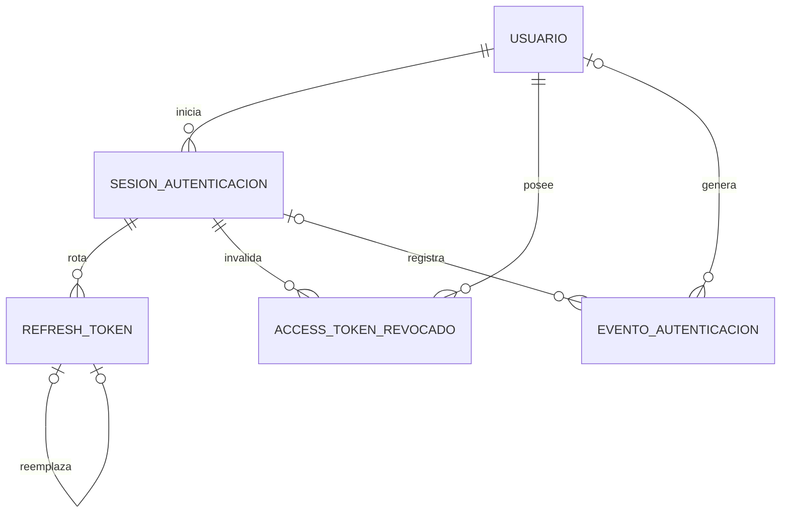

# Modelo entidad-relación V1

Este diagrama representa la estructura persistente definida por las migraciones `V1`, `V2` y `V3`. La migración SQL es la fuente ejecutable; el diagrama permite comprender las relaciones principales sin sobrecargarlo con atributos.

Los atributos, tipos, restricciones y descripciones de cada columna se consultan en las migraciones Flyway mediante los comentarios PostgreSQL (`COMMENT ON`) y en el [diccionario de datos](../wiki/Modelo-de-Datos-V1.md).

## Experiencias, reservas y operación

**Regla estructural principal:** todos los `DETALLE_RESERVA` de una `RESERVA` deben referir servicios programados para su misma `SALIDA_EXPERIENCIA`. Así se permiten combinaciones libres dentro de una experiencia y fecha, sin mezclar destinos incompatibles.

## Autenticación, sesiones y revocación

Los tokens reales no aparecen en el modelo ni se persisten: solamente hashes de refresh token y el `jti` de JWT revocados.
