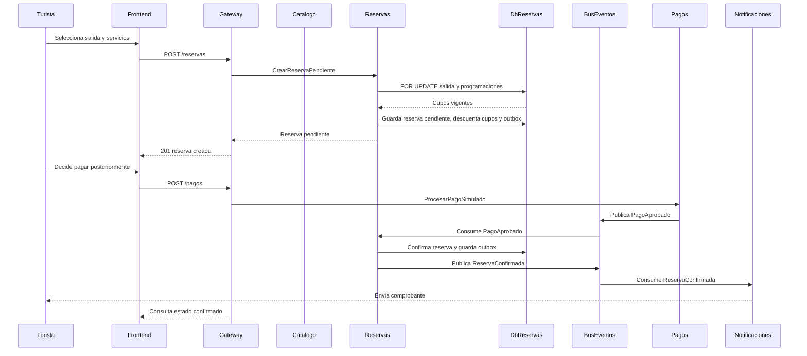

# Secuencia V2: reserva pendiente, pago explícito y notificación

Esta secuencia representa el camino exitoso. El diagrama de flujo complementario muestra los caminos de rechazo, expiración y liberación del cupo.

> La imagen es la versión de presentación. El Mermaid siguiente conserva la fuente editable y precisa de la secuencia.

## Mensajes relevantes

| Mensaje | Tipo | Garantía |
| --- | --- | --- |
| `POST /reservas` | Sincrónico | Crea una reserva pendiente y decide localmente si puede comprometer cupos. |
| `POST /pagos` | Sincrónico | Solo se invoca por la acción explícita de pago del cliente. |
| `PagoAprobado` | Asíncrono | Se publica desde el outbox de Pagos y se procesa de forma idempotente en Reservas. |
| `ReservaConfirmada` | Asíncrono | Permite notificar y actualizar proyecciones sin bloquear la reserva. |
